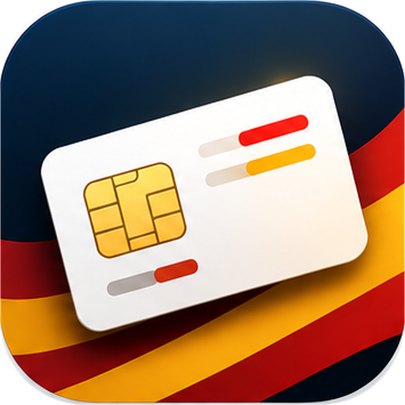

<p align="center">
  
</p>

<h1 align="center">DNIe Bridge</h1>

<p align="center">Native Spanish DNIe authentication for macOS</p>

<p align="center">
  <a href="https://emcrisostomo.github.io/dnie-macos/">Website</a>
  ·
  <a href="#build-from-source">Build from source</a>
  ·
  <a href="SECURITY.md">Security</a>
</p>

Use your Spanish DNIe with native macOS applications. DNIe Bridge exposes the card’s
Authentication identity through Apple’s CryptoTokenKit, allowing Safari and other
compatible apps to request authentication and signatures without a browser-specific
PKCS#11 module.

## Features

- Native macOS identity selection and system PIN prompts.
- On-card authentication and signing: the card’s private keys stay on the DNIe.
- USB smart-card readers supported by the macOS smart-card stack.
- Make commands for building, installing, inspecting, and uninstalling a development build.

**Experimental:** the current target is Apple silicon, macOS 26 or later, and DNIe 4.0.
Signed installer distribution and installation on a clean Mac are still being validated.

## Build from source

### Requirements

- An Apple silicon Mac with macOS 26 or later.
- Full Xcode with a macOS 26 or later SDK and Swift 6.2 or later. Select it as the active
  command-line developer directory.
- Python 3.9 or later, `jq`, and the macOS-provided Make.
- An Apple Development signing identity in your Keychain. See Apple’s
  [signing identity setup instructions](https://developer.apple.com/documentation/xcode/sharing-your-teams-signing-certificates); in Xcode’s
  certificate manager, choose **Apple Development**.

A supported USB CCID reader and a DNIe are needed to use the built app, but not to
run the offline checks.

### 1. Clone the repository

```sh
git clone https://github.com/emcrisostomo/dnie-macos.git
cd dnie-macos
```

### 2. Prepare the terminal data

The build needs generation-2 terminal data derived from OpenSC. This is shared protocol
data, distinct from your DNIe PIN and the private keys held by your card. Its values are
not stored in this repository.

```sh
make prepare
```

This downloads and verifies the DGP ARM package and OpenSC inputs, then creates the
Git-ignored local resource. It extracts the DGP library without installing middleware.
Valid existing data is verified and reused. See the [preparation guide](Release/README.md#download-and-prepare-for-a-development-build)
for prerequisites and offline inputs.

### 3. Build

Run Make as your normal user:

```sh
make build
```

If you have multiple Apple Development identities, select one with
`DNIE_SIGNING_IDENTITY_SHA1="YOUR_40_HEX_FINGERPRINT" make build`. Replace the placeholder with
your chosen identity’s 40-hex fingerprint.

## Install and use

```sh
make install
make status
```

Installation may request macOS administrator authorization. Insert your DNIe and select
its Authentication identity when a compatible app requests a certificate. Enter your PIN
only in the native system prompt. See [security guidance](SECURITY.md) before testing a card.

To uninstall the development build installed by this workflow:

```sh
make uninstall
```

## Reader and card information

```sh
make card-info
```

Shows live reader-slot/card state and, separately, native key references with the
DNIe authentication and signature labels in the Data Protection keychain. It opens no card session and requests no PIN.
These observations do not prove that a key belongs to a particular inserted card
or that authentication will succeed. An absent reader or card is a normal result. Keys not observed by this restricted
query may still be available through another keychain path.

## Tests and release packages

Run the offline checks without a card or terminal-data resource:

```sh
make check
make release-test
swift test --package-path Packages/DNIeCore
```

For the pinned release toolchain, unsigned package builds, repeatability checks, Developer ID
signing, and notarization, see the [release guide](Release/README.md). It also documents
installer lifecycle limitations. Automatic updates are not available.

## License

Original project code is licensed under [GPL-3.0-or-later](LICENSE). See the
[third-party and resource notices](LICENSES/README.md) for attribution and applicable terms.
